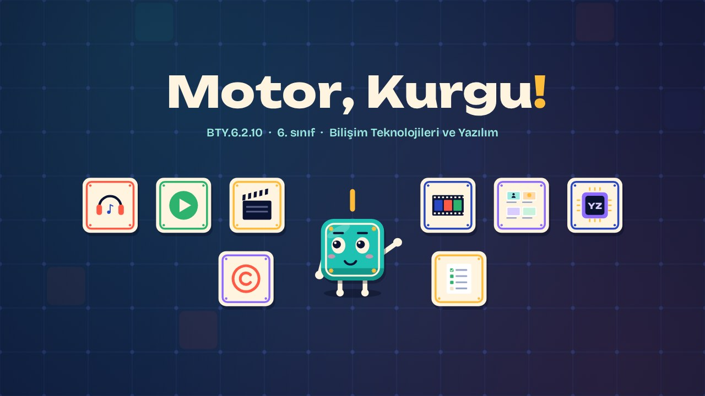
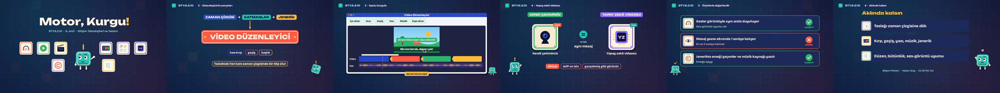

# Motor, Kurgu! · Action, Edit!

**▶ Tarayıcıda izleyin / Watch in the browser:** https://hakanatas.github.io/motor-kurgu/ 
**⬇ MP4 + altyazılar / MP4 + subtitles:** [Releases](https://github.com/hakanatas/motor-kurgu/releases) 
**✎ Kullanılan istem / The prompt behind it:** [PROMPT.md](PROMPT.md) 
**🎞 Bütün filmler / All films:** [Bilişim Filmleri](https://hakanatas.github.io/bilisim-filmleri/?sinif=6)

> **TR —** 6. sınıf Bilişim Teknolojileri ve Yazılım dersinin "Dijital Ürün Tasarımı ve Geliştirme" temasındaki BTY.6.2.10 öğrenme çıktısı için hazırlanmış, tamamen JavaScript ile çizilen 2,0 dakikalık animasyon; ses efektleri ve hafif fon müziği de kodla üretilir. "Ekranı bırak, dışarı çık!" kamu spotunun çekim taslağı bir video dosyasına dönüştürülür. Video düzenleyicinin bileşenleri (zaman çizgisi, görüntü-ses-yazı katmanları, geçişler, başlık ve jenerik) tanıtılır. Çekilen klipler içe aktarılır, 30 saniyeye kırpılır, geçiş, mesaj yazısı ve müzik eklenir, video dışa aktarılır. Kendi çekimimiz yapay zekâ ile üretilen videoyla telif, izin ve güvenilirlik yönünden karşılaştırılır. Son olarak video görsel düzen, kurgu bütünlüğü ve ses-görüntü uyumu ölçütleriyle değerlendirilir. Altyazılar Türkçe, İngilizce ya da ikisi birlikte seçilebilir.

A 2.0-minute animation, with code-generated sound, for **6th-grade IT and Software** (Türkiye Yüzyılı Maarif Modeli). The public service spot's storyboard becomes a video: timeline, layers, transitions, titles and credits are introduced; clips are imported, trimmed to 30 seconds, given transitions, a message and music, and exported; our footage is compared with AI-generated video; and the result is checked for layout, flow and sound-picture sync. The guide is **Karo**, a living glazed tile who never speaks: he tells the story with his face, his arms and the blinking cursor above his head.

## Öğrenme çıktısı · Learning outcome

MEB, Türkiye Yüzyılı Maarif Modeli, Bilişim Teknolojileri ve Yazılım Dersi Öğretim Programı, 6. sınıf, 2. tema "Dijital Ürün Tasarımı ve Geliştirme":

**BTY.6.2.10. Video dosyası geliştirebilme**
- a) Tasarlanan hikâye/senaryo unsurlarından uyumlu bir video dosyası oluşturur.
- b) Oluşturulan videoyu belirlenen ölçütler açısından değerlendirir.

## Sahneler · Scenes

| # | Zaman | Sahne | Ne oluyor | Çıktı |
|---|---|---|---|---|
| 1 | 0:00–0:16 | Giriş |  |  |
| 2 | 0:16–0:45 | Düzenleyicinin parçaları | Zaman çizgisi, katmanlar, geçiş, başlık ve jenerik. | a |
| 3 | 0:45–1:14 | Spotu kurgula | İçe aktar, kırp, geçiş, mesaj yazısı, müzik ve dışa aktar. | a |
| 4 | 1:14–1:24 | Yapay zekâ videosu | Kendi çekimimiz ile yapay zekâ videosunun karşılaştırılması: telif, izin, güvenilirlik. | a, b |
| 5 | 1:24–1:45 | Ölçütlerle değerlendir | Görsel düzen, kurgu bütünlüğü ve ses-görüntü uyumu. | b |
| 6 | 1:45–2:01 | Aklında kalsın |  |  |

## Çalıştırma · Running it

- **Önizleme:** `index.html` dosyasına çift tıklayın (çevrim dışı da çalışır). Klavye: boşluk oynat/duraklat, ← → 3 sn, Home başa. Adrese `?altyazi=en`, `?bicim=vertical` ya da `?ses=0` eklenebilir.
- **MP4:** bir kez `npm install`, sonra `npm run export -- --format=both --captions=tr` (720p yatay ve dikey, sesli). Google Chrome yüklüyse Playwright onu kullanır (`channel: 'chrome'`); ffmpeg gerekir.
- **Altyazı ve seslendirme notları:** `npm run srt` → `out/motor-kurgu_tr.srt`, `_en.srt`, `_tr-en.srt`, `_seslendirme-notlari.txt`.
- **Sürüm dosyaları:** `npm run release` → `release/` klasöründe v1.0'ın 6 dosyası.
- **Yazı kontrolü:** `npm run check` yatay ve dikey düzende, üç altyazı seçeneğiyle üst üste binen, kenardan taşan ya da 720p'de 17 pikselden küçük kalan yazı arar.
- **Düzenleme:** senaryo (sahneler, altyazılar, seslendirme notları) `scenes/film.js` içindedir; değiştirince `npm run build` süreleri, `captions.js` ve `film.config.js` dosyalarını yeniden üretir. Sahne şablonları `src/kit/`, Karo `src/draw/karo.js`, ses `src/audio/synth.js`.

Her kare `renderFrame(t)` ile zamanın saf fonksiyonu olarak çizilir; rastgelelik tohumludur, MP4 ekran kaydı değil kare kare üretimdir. Ses de dosyadan çalınmaz: aynı olay listesinden hesaplanır. Yazı tipleri: Unbounded ve Bricolage Grotesque (SIL OFL 1.1), dosyaya gömülü.

## Lisans · License

**TR —** Bu film ve kodu [Creative Commons Atıf-GayriTicari 4.0 Uluslararası (CC BY-NC 4.0)](https://creativecommons.org/licenses/by-nc/4.0/deed.tr) lisansıyla paylaşılır. Ticari olmayan her amaçla (derste, okulda, eğitim materyalinde) kopyalayabilir, paylaşabilir ve değiştirebilirsiniz; ancak **kaynak göstermek zorunludur**: eser sahibinin adı ve bu deponun bağlantısı belirtilmeden kullanılamaz. Ticari kullanım (satış, ücretli ürün ya da yayın) için izin alınmalıdır.

**EN —** This film and its code are licensed under [Creative Commons Attribution-NonCommercial 4.0 International (CC BY-NC 4.0)](https://creativecommons.org/licenses/by-nc/4.0/). You may copy, share and adapt them for non-commercial purposes, but **attribution is required**: they may not be used without crediting the author and linking to this repository. Commercial use requires permission.

Atıf örneği / Required credit: *“Motor, Kurgu!”, Hakan Ataş, Bilişim Filmleri — https://github.com/hakanatas/motor-kurgu — CC BY-NC 4.0*
